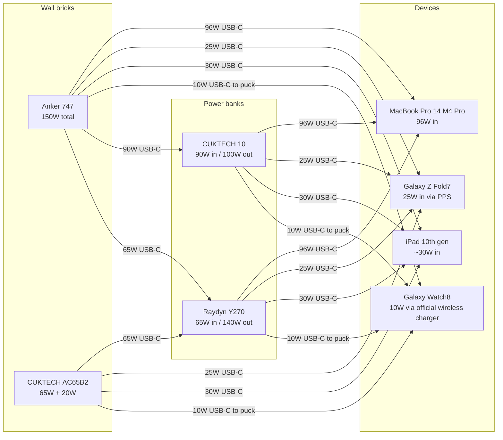
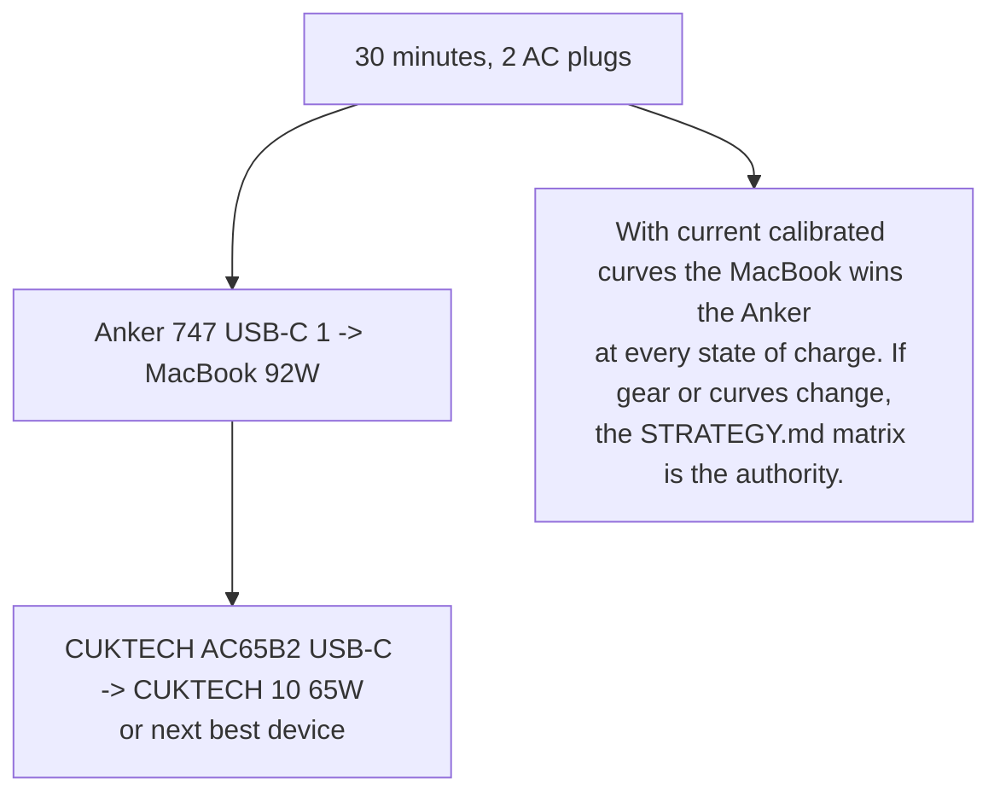

# Charge Arsenal

Personal database of power banks, wall bricks, and cables, plus a matcher that
answers one question: **which port do I plug into which, to move the most watts
in the least time?**

The goal is airport-layover math: minimum minutes stuck at a wall outlet,
maximum watt-hours back into the pack.

## Quick start

```sh
python3 scripts/match.py
```

This regenerates [MATCHES.md](MATCHES.md) with every brick x bank x cable
pairing and every brick/bank x device x cable pairing, ranked by negotiated
watts, plus estimated time-to-full and watt-hours recovered per 30-minute wall
session.

```sh
python3 scripts/strategy.py
```

This regenerates [STRATEGY.md](STRATEGY.md), the 30-minute, two-AC-plug
state-of-charge priority matrices for the Anker 747 and CUKTECH AC65B2.

```sh
python3 scripts/view.py
```

This regenerates [docs/index.html](docs/index.html), the static viewer for
GitHub Pages: arsenal table, 30-minute gain chart, best routes, multi-port
allocation scenarios, measured observations, and input taper curves (when
curve data exists). No third-party dependencies; light and dark themes.

## Current arsenal

| Device | Role | Key numbers |
| --- | --- | --- |
| Raydyn Y270 (Shenzhen Yonglian Tech) | 27000mAh / 99.3Wh power bank | 65W max input per vendor (reviewer measured ~100W peak); 140W max single-port output, 250W total output |
| CUKTECH 10 | 10000mAh / 37Wh power bank | 90W max input (86W measured), 100W USB-C PD output, 150W total output |
| Anker 747 Charger (GaNPrime 150W, A2340) | 4-port wall brick | 100W max per USB-C port, PPS 3.3-11V/5A, 150W total shared output |
| CUKTECH AC65B2 (Lighter 65W, 2C) | 2-port wall brick | 65W USB-C 1 (20V/3.25A) + 20W USB-C 2; PPS 5-11V/3A + 5-20V/3A measured |
| Samsung Galaxy Z Fold7 | Phone | 4400mAh / 16.95Wh, 25W wired charging via PPS (~22W measured) |
| Apple iPad 10th generation | Tablet | 28.6Wh, ~30W real ceiling via the 15V PDO (not 20W) |
| Apple MacBook Pro 14-inch M4 Pro | Laptop | 72.4Wh, 96W charger but ~88-92W measured ceiling |
| Samsung Galaxy Watch8 | Smartwatch | 44mm: 435mAh / 40mm: 325mAh, 10W via official EP-OL300 USB-C puck (5V/2A) |

## Charge map

This chart shows the best single-port route from each wall brick or power bank
to each charge target. The Anker 747's 150W total is shared when more than one
port is used, so these are best-case routes rather than simultaneous limits.



The Galaxy Watch8 is modeled as a 10W USB-C-fed target through Samsung's
official magnetic wireless charger, not as a direct USB-C port on the watch.

## Two-plug priority chart

This is the 30-minute decision tree when you have two AC wall plugs: one
Anker 747 and one CUKTECH AC65B2.



## 30-minute gain ranking

The current chart (taper-curve-based, interactive) is in the
[static viewer](docs/index.html). The legacy flat-model chart lives at
[charts/30-minute-gain.svg](charts/30-minute-gain.svg).

## Fastest routes

### Wall -> Raydyn Y270

- **Best port:** any USB-C port on the Anker 747 or the CUKTECH AC65B2 (C1), into
  either USB-C port on the Y270.
- **Best speed:** 65W (20V/3.25A) per vendor spec — but one reviewer measured
  ~100W initial input from a 100W PD charger before taper, so the real ceiling
  is contested. A 3A cable caps any source at 60W.
- **Cable:** the Y270’s included 100W cable, the CUKTECH 100W USB-C cable that came with the AC65B2
  cable, or the CUKTECH 10’s included 240W cable all work.
- **Capacity caveat:** the same reviewer measured only 74Wh input for a full
  recharge (~20000mAh), well short of the 27000mAh label.

### Wall -> CUKTECH 10

- **Best port:** any USB-C port on the Anker 747, into the CUKTECH 10’s USB-C
  port.
- **Best speed:** 90W (20V/4.5A) rated; measured 86W peak (20V/4.3A), full in
  44-46 min. The Anker’s USB-C port can supply 100W, but the bank caps input at
  90W.
- **Cable:** use the CUKTECH 10’s included 240W/6A cable. The CUKTECH AC65B2
  card charger tops out at 65W and cannot saturate this bank.

### Raydyn Y270 -> device

- **Best port:** use either USB-C port by itself.
- **Best speed:** 140W (28V/5A) with a 240W/EPR-rated USB-C cable, such as the
  CUKTECH 10’s included cable — no meter has verified the 28V output; only
  20V/3A has been observed.
- **Cable gotcha:** the Y270’s included 100W cable limits output to 100W
  (20V/5A), not 140W.
- **Multi-output gotcha:** multiple reports say all ports drop to 5V when more
  than one output port is in use.

### CUKTECH 10 -> device

- **Best port:** use the USB-C port by itself.
- **Best speed:** 100W standard PD (20V/5A) with the included 240W/6A cable —
  metered constant with no throttling.
- **PPS:** 5-11V/5A and 5-20V/3A — full-speed Samsung Super Fast Charging.
- **Proprietary exception:** compatible Xiaomi devices can negotiate up to
  120W via Xiaomi’s proprietary fast-charge protocol, not standard USB-C PD.

### Devices

- **Galaxy Z Fold7:** use a PPS-capable USB-C port — the Anker 747, CUKTECH
  AC65B2, and CUKTECH 10 all meter PPS covering Samsung SFC; the Y270's PPS is
  undocumented (unverified — modeled at the conservative 15W fallback).
  Practical ceiling is **~22W measured** (9V/2.5A PPS); the phone is the
  bottleneck, not the brick or bank.
- **iPad 10th generation:** use any USB-C port that offers a 15V PDO. Practical
  ceiling is **~30W** (not 20W) — the bundled 20W adapter is 9V-locked.
- **MacBook Pro 14-inch M4 Pro:** use any Thunderbolt 4 / USB-C port. The
  Anker 747, Y270, or CUKTECH 10 all land in the laptop's measured **88-92W**
  ceiling; the CUKTECH AC65B2 (C1) tops out at **65W**.
- **Galaxy Watch8:** 10W cap through Samsung’s official EP-OL300 puck (5V/2A);
  a bigger brick gains nothing.

### Charging both banks at once

The Anker 747 can use two USB-C ports at once, but they share a 150W total
ceiling with no fixed per-port split. See the multi-port allocation model below.

## Multi-port allocation

Modeled as of 2026-11-19, verified against [Anker's official tables](https://service.anker.com/product-description/a085g000004xGpeAAE),
[chongdiantou's metered review](https://www.chongdiantou.com/archives/190475.html),
and the [USB-IF Shared Capacity Charger spec](https://www.usb.org/sites/default/files/USB_Type-C_Shared_Capacity_Interoperabiltiy_CTS_0.8.pdf).
`scripts/match.py` renders the full two-device scenario table into
[MATCHES.md](MATCHES.md).

- **Budget, not per-port promise:** the Anker 747's 150W is shared across all
  ports in use; any single USB-C port alone can grant 100W.
- **No fixed C+C split:** Anker publishes none. PowerIQ 4.0 allocates
  dynamically — two high-draw laptops balance near 75W + 75W (measured
  71.6W + 67.6W), but a high-draw primary can starve the second port: the Y270
  measured ~25W behind a charging MacBook, where the first-order model
  estimates 54W. Treat the second port behind a charging laptop as a ~25-50W
  slot.
- **USB-A gotcha:** USB-C1 + USB-A collapses to 24W total (5V/4.8A). Put the
  laptop on USB-C2 or C3 whenever USB-A is in use (100W + 22.5W).
- **Mechanism:** per the USB-IF Shared Capacity Charger rules, whenever a
  power contract is made or changed on any port, the source recomputes the
  remaining shared power and re-sends Source_Capabilities; sinks re-Request
  without a Hard Reset. The protocol does not change (the Y270 kept its 20V
  contract in both measured cases) — only the granted current does.
- **Bank caveats:** the Y270 has no documented dual-input (treat as
  unsupported), slows its own recharge in pass-through, and one staff review
  reports all outputs dropping to 5V when multiple output ports are used
  (unverified — worth a meter check).

### Measured observations

Real-world readings live in [`data/measurements.json`](data/measurements.json)
— both owner readings (gold-standard `measured`) and third-party tester readings
(`measured-third-party`):

| Source | Reading | Why |
| --- | --- | --- |
| Owner: Anker 747 second USB-C port, MacBook charging on the first | **~25W @ 20V** (Y270) | Same 20V PD contract, but the shared budget gave the MacBook priority and granted ~1.25A. Testers see the same starvation transient (a port cut from 20V/3.25A to 20V/2.2A on plug-in) — the ceiling returns to ~75W once both sides renegotiate |
| Owner: CUKTECH AC65B2 alone | **~60W @ 20V** (Y270) | Single-device 20V/3A contract; its 20V/3.25A C1 ceiling binds |
| Reviewer: 100W PD charger | **~100W initial → 50-60W** (Y270) | Above the 65W vendor rating; same tester measured 74Wh input for a full recharge (~20000mAh real) |
| Reviewer: Apple 140W | **86W @ 20V/4.3A** (CUKTECH 10) | 44-46 min full; 55%-in-15-min claim confirmed |
| Tester: any 96W+ source | **88-92W @ 20V/~4.5A** (MacBook 14) | The laptop never draws its adapter's full 96W |
| Tester: Apple 67W | **30W @ 15V** (iPad 10) | Real ceiling ~29-30W; the bundled 20W adapter is locked to 9V |

Takeaway: a multi-port brick does not change the negotiated *protocol* — the
Y270 got 20V in every case — it changes the *current* the source grants at that
voltage. See the multi-port allocation model above.

## PPS and taper modeling

- **PPS (Samsung Super Fast Charging):** the Anker 747 meters PPS 3.3-11V/5A on
  all three USB-C ports; the CUKTECH 10 meters 5-11V/5A and 5-20V/3A; the
  CUKTECH AC65B2 meters 5-11V/3A and 5-20V/3A. The Z Fold7 needs
  3.3-11V at >=2.75A and converges at ~9V/2.5A = 21.6-22.9W on any PPS source,
  so the matcher models a 22.5W PPS contract for it and 45W/100W/140W bricks
  gain nothing. Without PPS Samsung's guidance is a ~15W fallback (one bench
  measured ~23W from plain 9V PD; disputed — the model follows the safe rule).
- **Taper curves:** two forms live in the entries. `charge_curves` (minutes → input
  watts) are the measured, time-based records the viewer charts.
  `soc_curves` (SOC% → watts, derived from published SOC milestones) are what
  `soc_gain()` integrates, so a 30-minute gain depends on where the battery
  starts: the MacBook gains ~37 Wh from 0% but ~10 Wh from 80%, and an 80%+
  battery now loses the Anker 747 in the strategy matrix. When a source can't
  feed a curve's peak, the curve scales down. Flat first-order estimates remain
  the fallback for entries without measurements.
- **Key curves:** MacBook (measured 70W curve + derived 96W-class curve);
  CUKTECH 10 self-charge (calibrated to the 37.3 Wh metered input);
  Z Fold7 and iPad derived from published SOC milestones (approximate);
  Y270 a two-step time approximation (one reviewer). Watch8 efficiency is set
  to 0.15 because the 10W puck delivers only ~1.5W into the watch.

## Device cheat sheets

### Raydyn Y270

- 27000mAh / 99.3Wh
- 2x USB-C bidirectional PD 3.1, 1x USB-A output-only
- 65W max input per vendor (20V/3.25A); reviewer measured ~100W initial, tapering to 50-60W
- 140W max single USB-C output (28V/5A) — unverified by any meter
- 250W total output across all ports
- Included cable is 100W / 20V / 5A, so it caps output at 100W
- Reviewer capacity test: 74Wh input for a full recharge (~20000mAh at 3.7V); unit returned
- Multiple reports: all ports drop to 5V in 3-device simultaneous use; no documented dual-input; PPS undocumented

### CUKTECH 10

- 10000mAh / 37Wh
- 1x USB-C bidirectional, 1x USB-A output
- 90W max input (20V/4.5A); measured 86W, full recharge 44-46 min
- Usable output 30.2-31.9Wh USB-C (83.9-88.6%), 27.4Wh USB-A
- 100W max USB-C standard PD output (sustained, no throttle); 120W Xiaomi private (20V/6A)
- PPS 5-11V/5A and 5-20V/3A
- Included cable is 240W / 6A USB-C, PD 3.1 capable
- Multi-port C+A combined output disputed (manual table vs marketing)

### Anker 747 Charger (A2340)

- 3x USB-C, 1x USB-A
- 100W max on any USB-C port when used alone; PPS 3.3-11V/5A on all three
- 22.5W max on USB-A (no PD)
- 150W total shared output; dynamic allocation, re-advertised PDOs capped by remaining budget
- Measured efficiency 87.3-94.4%; 65.6-69.9 °C surface after 1h at 100W without derating
- Measured two-device splits: 75W+75W (two laptops), 100W+24W rule (C1+USB-A)

### CUKTECH AC65B2 (Lighter 65W, 2C)

- 2x USB-C: C1 65W (5/9/12/15V⎓3A, 20V⎓3.25A) + C2 20W (5V/3A, 9V/2.25A)
- PPS on C1: 5-11V/3A and 5-20V/3A (metered) — covers Samsung SFC 25W
- Dual-port: 39W+18W or 45W+10W (2023 revision); 45W+18W/63W (original)
- Revision caveat: two hardware revisions share the AC65B2 code — original
  white 100-240V (C1 derates to 45W on 100-130V mains), 2023 silver 200-240V
  only. Check the input line on the label
- Measured: 86-93.8% efficiency, 59.6 °C after 1h at 65W, 63W sustained for
  1h09m into a MacBook Pro 16 (full charge 2h20m), standby 0.099W

### Samsung Galaxy Z Fold7

- 4400mAh / 16.95Wh
- 25W-class wired charging via PPS 3.3-11V >=2.75A; measured ~9V/2.5A = 21.6-22.9W on any PPS charger
- Measured (GSMArena): 28% in 15 min, 53% in 30 min, full in 1h27m
- 15W wireless charging; no reverse PowerShare tier in the model

### Apple iPad 10th generation

- 28.6Wh battery
- Real ceiling ~29-30W via the 15V PDO (30.06W measured); only 19.6W from the bundled 20W adapter (9V-locked)
- Measured full charge ~2h14-2h32 depending on charger

### Apple MacBook Pro 14-inch M4 Pro

- 72.4Wh battery
- MagSafe 3 and three Thunderbolt 4 / USB-C charging ports
- 96W adapter, but measured input ceiling ~88-92W from any source
- Measured 0-100%: ~93 min on 96W-class, 107 min on 70W; 50% in ~30 min
- Under full system load the adapter saturates and charging slows or pauses

### Samsung Galaxy Watch8

- 44mm model: 435mAh battery; 40mm: 325mAh; Classic 46mm: 445mAh
- Official EP-OL300 puck: USB-C input 5V/2A (10W), PD-capable adapter required
- Higher-watt bricks gain nothing — the puck is the bottleneck
- Measured 0-100% ~1h19m-1h54m; 45% in 30 min
- The watch itself has no USB-C port; the model tracks the puck input

## Data model

All data lives in `data/` as plain JSON:

- `powerbanks.json` - the banks themselves
- `bricks.json` - wall chargers
- `cables.json` - the wires that quietly decide everything
- `devices.json` - phones, tablets, laptops, and other charge targets
- `measurements.json` - USB-meter / display readings from real sessions

Each USB-C port carries separate `input` and `output` blocks with a `max_w`
ceiling and a list of `pd_profiles` (voltage/current pairs). The matcher picks
the highest shared profile that the cable can physically carry, so a weak cable
or a missing 20V rail shows up as a lower negotiated wattage instead of a
mystery. Two extensions sit alongside:

- ports may advertise `pps_profiles` (voltage window + amps); sinks that
  declare a `pps` block get the PPS contract (see the Z Fold7 entry)
- charge targets may carry `charge_curves` (minutes → input watts, with the
  source they were measured on) and `soc_curves` (SOC% → watts);
  `charge_estimate()` and `soc_gain()` integrate them

## Adding gear

1. Copy an existing entry in the relevant `data/*.json` file.
2. Fill in real numbers from the device label, manual, a USB power meter, or a
   metered third-party review.
3. Run `python3 scripts/match.py` and commit the regenerated `MATCHES.md`.

## Data confidence

Every device entry carries a `data_confidence` field:

- `researched-listings` - numbers taken from manufacturer/listing pages, not
  independently verified.
- `reviewer-measured` - numbers from metered third-party tests (ChargerLAB,
  chongdiantou, POWER-Z reviews, notebookcheck, GSMArena, USB-tester customer
  reviews). Preferred over listings when they disagree.
- `measured` - verified by the owner with a USB power meter or the device's own
  V/A/W display. Gold standard; owner entries live in
  `data/measurements.json` (third-party readings are marked
  `measured-third-party` there).

## Roadmap

- Verify remaining third-party numbers with the owner's own USB power meter
  (highest value: Y270 real capacity and ~100W input, Y270 multi-output 5V
  collapse)
- Read the input line on the AC65B2 label: 100-240V (original, C1 derates to
  45W on 120V mains) or 200-240V (2023 revision)
